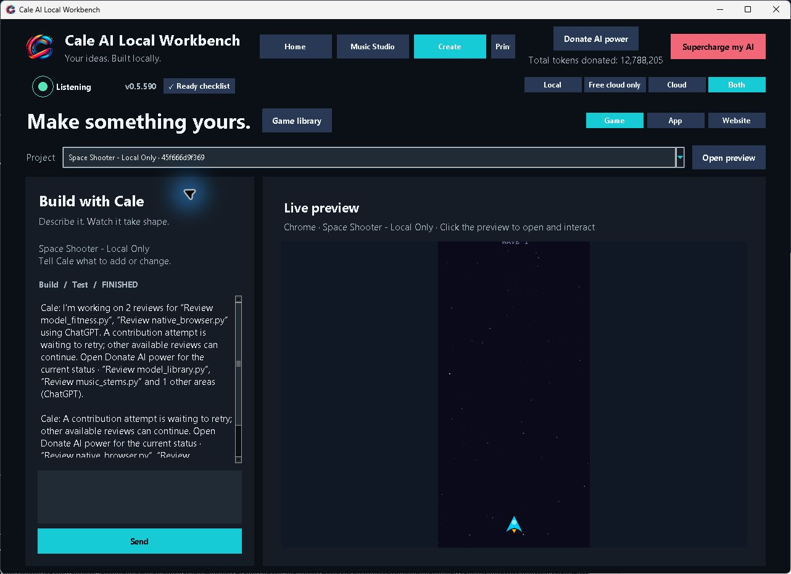
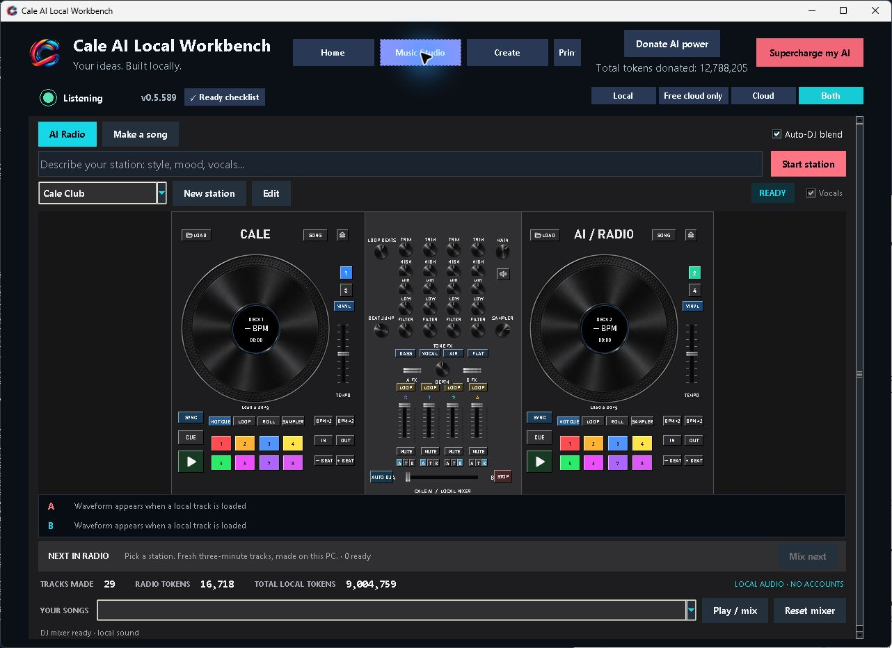
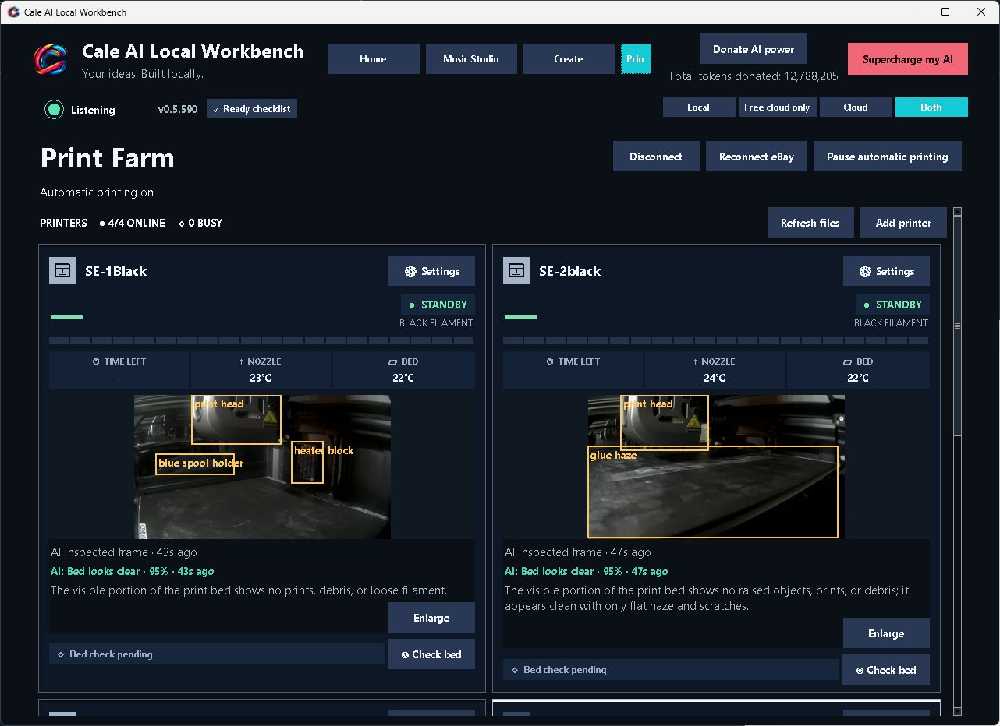

# Cale AI Workbench

**Your ideas. Built locally.**

A Windows AI workspace for building software, making music, working with documents and managing a print farm—powered by local models, practical tools and memory that lasts beyond a chat.

**[Download Windows installer (.exe)](https://github.com/CaleMediaDev/cale-ai-workbench/releases/latest/download/Cale-AI-Workbench-Setup.exe)** · [ZIP alternative](https://github.com/CaleMediaDev/cale-ai-workbench/releases/latest/download/Cale-AI-Workbench-Install.zip) · [Release notes & checksums](https://github.com/CaleMediaDev/cale-ai-workbench/releases/latest)

Windows x64 · Free, open-source app · No account required for local use

[See what it does](#what-it-can-do) · [Install](#install) · [Proven results](#proven-results) · [White paper](https://calemedia.com/cale-ai-workbench-white-paper/) · [Detailed guide](USER_GUIDE.md)

## Install

1. **[Download Cale-AI-Workbench-Setup.exe](https://github.com/CaleMediaDev/cale-ai-workbench/releases/latest/download/Cale-AI-Workbench-Setup.exe)** and open it.
2. Click **Install**. Setup downloads the required tools and models; keep an internet connection during this first setup.
3. Click **Open Cale AI** and describe what you want to make.

No manual Python, Git, Node or terminal setup is needed. Connecting cloud accounts is optional.

**Prefer a ZIP?** Download [Cale-AI-Workbench-Install.zip](https://github.com/CaleMediaDev/cale-ai-workbench/releases/latest/download/Cale-AI-Workbench-Install.zip), extract it, and open **Install Cale AI.exe**. GitHub's **Code → Download ZIP** is source code; use the installer links above to get the app.

The installer is a small download; models and runtimes require additional storage and download time. Hardware needs depend on the models and tools you choose. See [setup details](USER_GUIDE.md#install) and [model information](USER_GUIDE.md#models-included-in-the-project).

## What it can do

| Workspace | What you can explore |
| --- | --- |
| **Create** | Build and revise games, apps and websites with saved projects and a live preview. |
| **Music Studio & AI Radio** | Generate local music, play your songs, and mix audio with DJ decks and controls. |
| **AI Print Farm** | Monitor connected printers, temperatures and cameras, with AI-assisted bed inspections and automatic-printing controls. |
| **Documents & media** | Work with documents, images, speech, audio and video through specialist tools. |
| **Persistent tasks** | Keep plans, files, steps and checkpoints; resume work and verify results. |
| **Local learning** | Retrieve relevant user feedback and run opt-in, evaluated small-classifier training experiments. |

### Inside the actual app

| Create | Music Studio | AI Print Farm |
| :---: | :---: | :---: |
|  |  |  |

Actual development-build screenshots, captured November 7, 2026. Select an image to view it full size. These illustrate the interface; measured task results are linked below.

## Local models. More useful work.

Workbench combines a model with a working environment: tools execute actions, **SQLite** preserves project state, and saved checks help verify the output. The goal is to get more useful work from compact models and the computer you already own.

**Offline work:** once the required models, tools and files are installed, local workflows can run without a cloud inference service. Fully local, offline work can keep prompts, files and results on your computer. Downloads, web research, publishing and optional cloud integrations need a connection.

**Hardware:** the documented development PC uses a Ryzen 9 5900X, RTX 3060 with 12 GB VRAM and 128 GB RAM on Windows 11 Pro. This is a tested development configuration, not a minimum requirement. Broader testing on more modest PCs is part of the [roadmap](https://calemedia.com/cale-ai-workbench-white-paper/#roadmap).

## Proven results

The project publishes task receipts and retained failures so you can inspect what worked and under what conditions.

- **Local 9B software work:** application building, Python repairs and verification that caught deliberately introduced defects. [Browse the benchmark evidence](benchmarks/README.md).
- **Local document work:** a source-checked PDF workflow, recorded separately from the small-model coding runs. [Inspect the result](benchmarks/results/document-auto-20261103.json).
- **Local music:** recorded three-minute vocal-song renders and their validation limits. [Inspect the music evidence](benchmarks/results/managed-music-memory-558-20261106.json).
- **Specialist training:** an actual CPU training and evaluation run, including rejection of a candidate that scored below baseline. [Inspect the training receipt](benchmarks/results/model-donations-501-20261104.json).

These are specific demonstrations, not a guarantee that every task or PC will produce the same result. The [white paper](https://calemedia.com/cale-ai-workbench-white-paper/) connects the results, architecture, privacy model and development roadmap.

## Find your way around

| Looking for… | Start here |
| --- | --- |
| The app | **[Windows download](https://github.com/CaleMediaDev/cale-ai-workbench/releases/latest/download/Cale-AI-Workbench-Setup.exe)** |
| Setup and feature instructions | [Detailed user guide](USER_GUIDE.md) |
| What's changed | [Latest release](https://github.com/CaleMediaDev/cale-ai-workbench/releases/latest) · [All releases](https://github.com/CaleMediaDev/cale-ai-workbench/releases) |
| How it works | [Architecture](ARCHITECTURE.md) |
| Evidence and limitations | [Benchmarks](benchmarks/README.md) |
| The bigger picture | [White paper and roadmap](https://calemedia.com/cale-ai-workbench-white-paper/) |
| Bugs and feature requests | [GitHub Issues](https://github.com/CaleMediaDev/cale-ai-workbench/issues) |
| Contributing code | [Contribution guide](CONTRIBUTING.md) |

## Development

Start with [ARCHITECTURE.md](ARCHITECTURE.md), [CONTRIBUTING.md](CONTRIBUTING.md), and the [developer setup](USER_GUIDE.md#development). The full operational details and earlier feature history are preserved in [USER_GUIDE.md](USER_GUIDE.md).

### Small CPU classifier candidates

Opt-in training fits small specialist classifiers and evaluates held-out examples against baselines. This does not retrain the main assistant, and a training score does not activate a candidate. [Training and activation details](USER_GUIDE.md#small-cpu-classifier-candidates).

More feature and technical references

**Cale Radio:** [Read the detailed guide](USER_GUIDE.md#cale-radio).

**Donate AI power:** [Read the detailed guide](USER_GUIDE.md#donate-ai-power).

**Long tasks:** [Read the detailed guide](USER_GUIDE.md#long-tasks).

**Free cloud connection:** [Read the detailed guide](USER_GUIDE.md#free-cloud-connection).

**Models included in the project:** [Read the detailed guide](USER_GUIDE.md#models-included-in-the-project).

**Accepted donation credit:** [Read the detailed guide](USER_GUIDE.md#accepted-donation-credit).

**Durable capability recovery:** [Read the detailed guide](USER_GUIDE.md#durable-capability-recovery).

**Scoped host verification evidence:** [Read the detailed guide](USER_GUIDE.md#scoped-host-verification-evidence).

**Project-local expression helpers:** [Read the detailed guide](USER_GUIDE.md#project-local-expression-helpers).

## License

Cale's companion source is [MIT licensed](LICENSE). Bundled components, third-party runtimes and model weights retain their own licenses; see [asset information](ASSETS.md) and [model details](USER_GUIDE.md#models-included-in-the-project).

Built by **[Cale Media](https://calemedia.com)** in Howell, Michigan.
